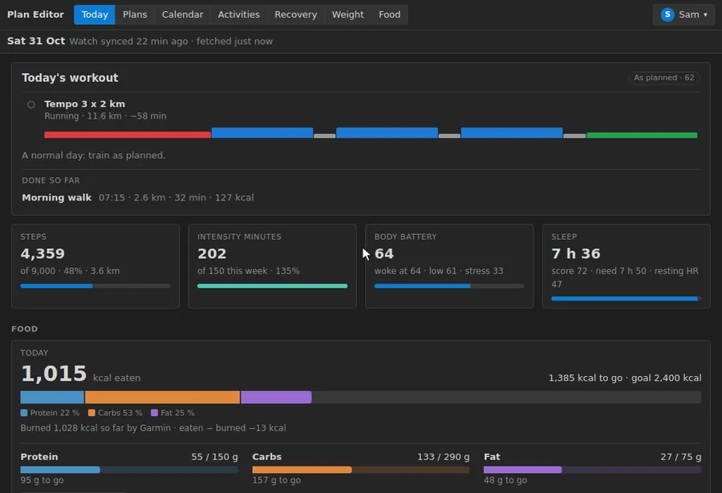
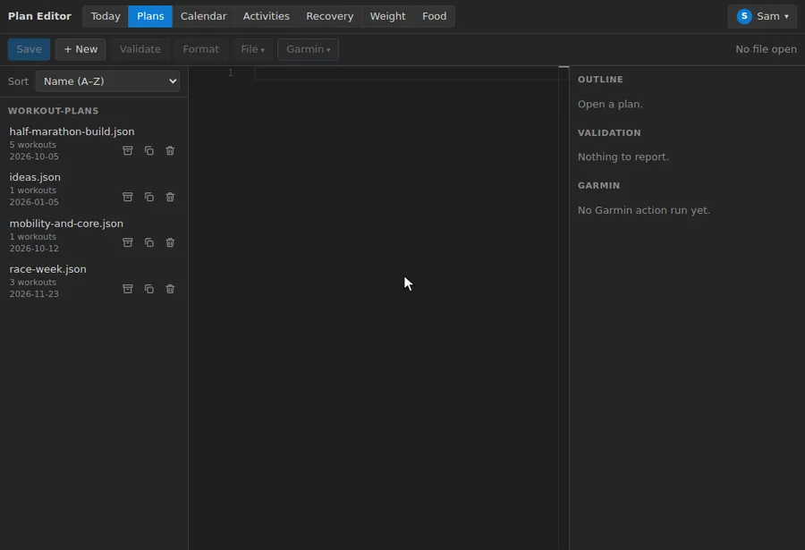
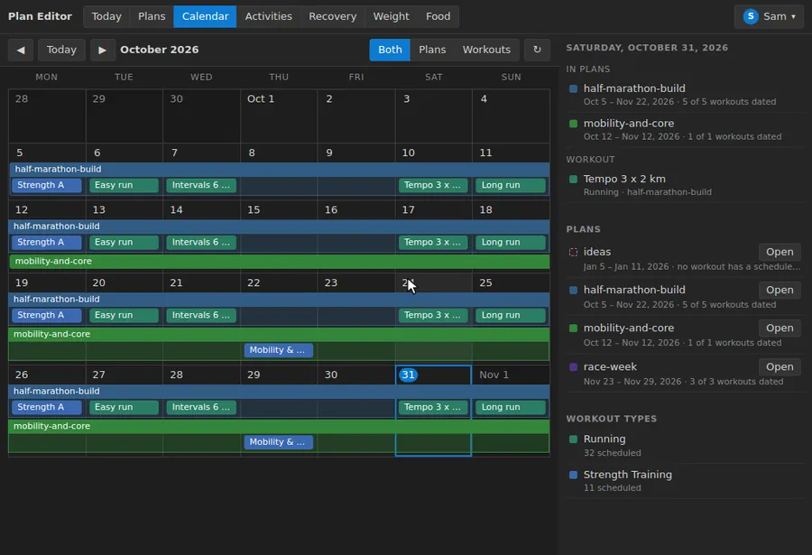
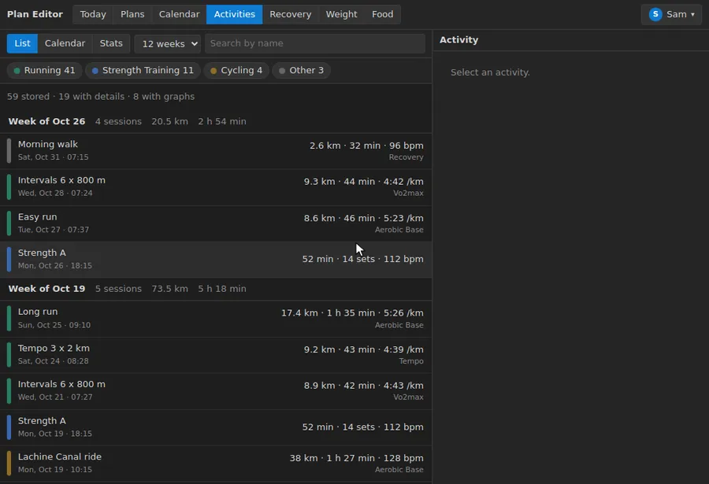
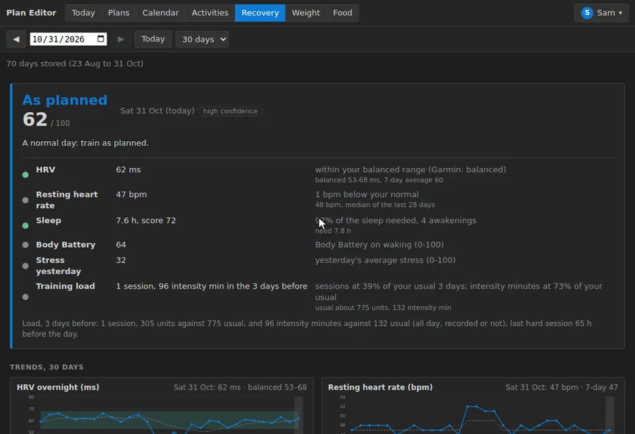
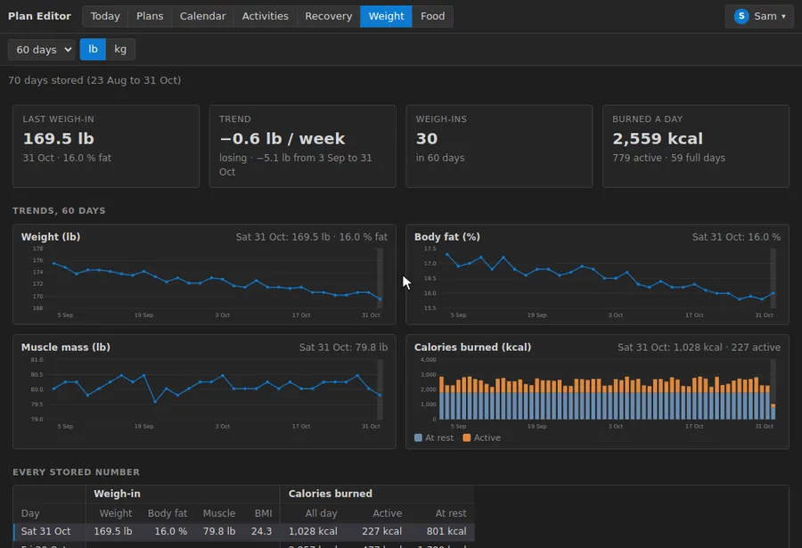
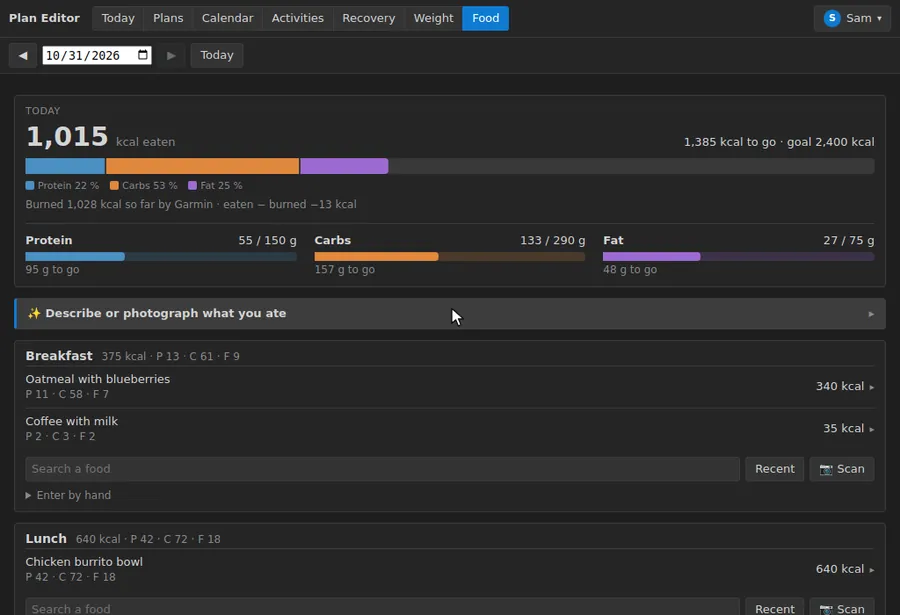
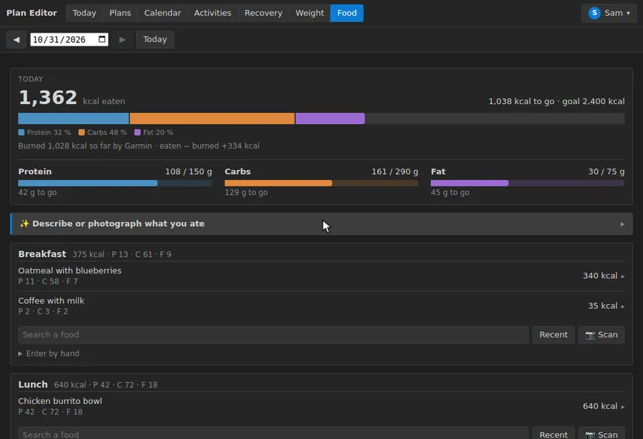
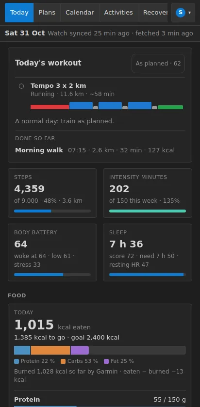

# Garmin Workout Editor

Edit your workout plans in a web editor or through Claude (MCP), log what you eat, and, if you have them, keep your Garmin activities and health data in a database and push workouts to Garmin. **Garmin is optional, and so is a Renpho scale**: a profile with neither still has the plan editor, the calendar and the food log.



Every recording below runs on the demo database (`npm run demo`, see [Try it with demo data](#try-it-with-demo-data)), so none of it is anyone's data.

## Features

- [Today](#today) · [Plans](#plans-a-json-editor-that-draws-the-workout) · [Calendar](#calendar) · [Activities](#activities-graphs-map-and-laps) · [Strength and lifetime stats](#strength-and-lifetime-stats) · [Recovery](#recovery-and-readiness) · [Weight](#weight) · [Food logging](#food-logging) · [Logging a meal with AI](#logging-a-meal-with-ai) · [On a phone](#on-a-phone) · [With Claude](#with-claude-mcp)

### Today

The page that opens first: the workout the plans schedule for today, drawn as its steps, with a ✓ once an activity was started from it; the day's readiness and what to do with it; steps, intensity minutes, Body Battery and last night's sleep against their goals; what you ate against your goals; and the workouts of the next 7 days with their distance and time. It always says how old the numbers are, and when the watch has not synced for a while.

### Plans: a JSON editor that draws the workout



Plans are JSON documents, edited in Monaco with the workout schema's autocompletion and the same checks as an upload, run as you type. The outline beside it lists the plan's workouts, each with a small profile; a name opens its picture (one block per step, height for effort, estimated time and distance from your own recent runs) and, for a strength workout, the muscles it trains, darker the more sets. Every save keeps the version it replaces. With a Garmin login, the *Garmin* menu uploads, schedules and sends a plan to the watch, and each workout shows whether Garmin's copy matches.

### Calendar



A month of what the plans schedule: *Both* draws each plan as a bar holding its workouts of the week, *Plans* only the bars (which weeks each plan covers, where they overlap), *Workouts* only the workouts, coloured by type. A day lists its plans and workouts; a chip opens the workout's picture.

### Activities: graphs, map and laps



Your Garmin history is stored once and read from the database. A run gets its heart rate (with the zones), pace, elevation and cadence graphs sharing one cursor, its route on an OpenStreetMap map coloured by pace or heart rate (hovering one moves the other), the watch's laps and kilometer splits, and the plan workout it was started from, compared with what was done.

### Strength and lifetime stats


A strength session shows the muscles it worked, each exercise with its sets (`3 × 5 @ 215 lb`) and each set as a share of your estimated one-rep max. The calendar can show the planned workouts beside the activities, done (✓) or missed. *Stats* adds everything up: best efforts over 1 km to 10 km, records, the biggest week and month, and every lift with its estimated 1RM.

### Recovery and readiness



A band for the day's workout, **go-harder**, **as-planned** or **back-off**, with a score and the signals behind it: HRV against Garmin's baseline, resting heart rate and sleep against your own normal, Body Battery, stress and recent training load. Below, seven charts over 14 to 90 days share one cursor; a click on a day shows its readiness. These are heuristics from watch data, not medical advice.

### Weight



The weigh-ins from Garmin or a Renpho scale (with or without Garmin): the trend a week, weight, body fat and muscle mass charts, and the calories burned at rest and active.

### Food logging



Each meal of the day has a search box, a barcode scanner and *Recent*. A search asks Open Food Facts (products sold in Canada first) and a quantity picker scales it; *Recent* logs a food again in one tap; a food typed by hand gets its calories from its macros. The day's calories, macros and nine Nutrition Facts nutrients are shown against your goals, with the calories Garmin says you burned when there is a Garmin login. The log is kept here, never sent to Garmin.

### Logging a meal with AI



Describe what you ate, or photograph the plate or a Nutrition Facts label, and Claude (on your Claude plan) or Gemini (free) estimates each food with its amount and meal; correct what is wrong and log them all at once. It needs one of them set up on the server (see [Install, step 4](#4-the-ai-food-box-with-claude-or-gemini-optional)). The estimate in this recording is a canned answer: the recorder does not call an AI.

### On a phone



Below 900 px wide every view is one pane at a time, the header's views scroll sideways, and a tap on a calendar day lists it below the grid. Add it to the home screen for its icon.

### With Claude (MCP)

The MCP server gives Claude the same data and actions: last week's activities, the plans, readiness, the food log. Ask it to *"review last week and adjust this week's plan"*, *"how recovered am I, should I still do the intervals?"* or *"log lunch: a chicken burrito bowl and a coffee"*. It edits the plan files, validates them, and touches Garmin only after you confirm. See [MCP Server](#mcp-server-claudeai--claude-desktop).

Not shown above: the *Workouts* view (your Garmin workout library beside the plans) and the *Garmin* menu, which need a Garmin login.

## Install

Two ways to run it: **on your computer** with Node (to try it, or for yourself on one machine), or **with Docker** on a server or a NAS (always on, and reachable from your phone). Both keep everything in one database file and read their settings from a `.env` file at the root of the checkout; [`.env.example`](.env.example) explains every setting.

### 1. Get the code

```bash
git clone https://github.com/MarcEtienneDery/garmin-workout-editor.git
cd garmin-workout-editor
```

### 2. Start it

**On your computer** (Node 22.13 or newer, for its built-in SQLite):

```bash
npm install
cp .env.example .env    # optional here: every line is commented out, the defaults work
npm run web             # the editor, http://127.0.0.1:8788
```

The database is created at `data/garmin.db`. Stop it with Ctrl+C; `npm run mcp` starts the MCP server for Claude Desktop (see [MCP Server](#mcp-server-claudeai--claude-desktop)).

**With Docker** (Docker with Compose; on a NAS, from a checkout of the repo):

```bash
mkdir -p data
echo "MCP_AUTH_TOKEN=$(openssl rand -hex 32)" >> .env    # the MCP server's secret
echo "WEB_AUTH_TOKEN=$(openssl rand -hex 16)" >> .env    # the editor's admin password
echo "CREDENTIALS_KEY=$(openssl rand -hex 32)" >> .env   # encrypts the Garmin and Renpho passwords you save
echo "TZ=America/Toronto" >> .env                        # your time zone, for "today"
docker compose up -d --build
```

The editor is on <http://127.0.0.1:8788> (`WEB_BIND=0.0.0.0` in `.env` to reach it from your network) and the MCP server on port 8787. Sign in with any user name and `WEB_AUTH_TOKEN` as the password. Keep `.env` safe and out of git (it is in `.gitignore`), and back up `data/garmin.db`. More in [Run it in Docker](#run-it-in-docker-eg-on-a-nas).

### 3. Add a profile

On the Today page of a new install press *Add a profile* (or *Settings → + Add profile*) and give it a name and a **web sign-in password, typed twice** (at least 8 characters; it is mandatory). Its plans, calendar and food log need nothing else. Once a profile has a password the editor asks for a sign-in: the name and the password you just chose.

- **Garmin and Renpho, optional, per profile, in Settings**: connect **Garmin** (email and password) to sync activities and health data and to send workouts to the watch, and a **Renpho** scale for weigh-ins (they show in the Weight view with or without Garmin; uploading them to Garmin needs a Garmin login). Views that need a connection that a profile does not have are left out of the header: Workouts needs Garmin; Activities and Recovery need Garmin or data stored from it; Weight needs Garmin, a Renpho scale or stored weigh-ins.
- A profile without Garmin needs a time zone for "today" (`TZ`, or `GARMIN_TZ`), as there are no activities to read it from.

### 4. The AI food box, with Claude or Gemini (optional)

The Food view works without it (search, barcode scan, recent foods, by hand); only the *✨ Describe or photograph what you ate* box needs an AI. Pick one:

| | **Claude**, on your Claude plan | **Gemini**, free |
|---|---|---|
| Costs | nothing more than a Claude Pro or Max plan you already have; each estimate uses the plan's usage limits | nothing: a free key from Google AI Studio, with a few estimates a minute and a daily number |
| Needs | a Claude Pro or Max subscription | a Google account, in a country where Gemini is offered |
| Your words and photos | go to Anthropic, to be read | go to Google, which **may keep them and use them to improve its products** on the free tier |
| In a test of 11 meals (October 2026) | all estimated in 3 to 6 s; logged nothing for a message that tried to slip in a fake food | all estimated in 1 to 5 s; close to Claude, a little lower when it had to guess a portion; logged nothing for the fake-food message |

**Claude, on your Claude plan.** Anthropic's API is billed apart from the plan; this asks through [Claude Code](https://claude.com/claude-code) (`claude -p`) instead, which runs on the plan.

1. On a computer where you can open a terminal, install Claude Code (`npm install -g @anthropic-ai/claude-code`), run `claude` once and sign in with your Claude account.
2. Run `claude setup-token` in that terminal. It prints a token that starts with `sk-ant-oat01-` and lasts a year. It signs in as you: keep it out of chats and screenshots.
3. Add to `.env`:
   ```bash
   FOOD_AI_BACKEND=cli
   CLAUDE_CODE_OAUTH_TOKEN=sk-ant-oat01-...
   ```
   On your own computer, where Claude Code is installed and signed in, `FOOD_AI_BACKEND=cli` alone is enough. The Docker image has Claude Code installed.
4. Restart: `docker compose up -d` (or stop and start `npm run web` again).

Every profile of the server asks on that one login. Renew the token before the year is out (`claude setup-token` again, then restart).

**Gemini, free.**

1. Open <https://aistudio.google.com/apikey>, sign in with a Google account and press *Create API key* (a key on a project without billing stays on the free tier).
2. Add to `.env`:
   ```bash
   FOOD_AI_BACKEND=gemini
   GEMINI_API_KEY=AIza...
   ```
3. Restart: `docker compose up -d` (or stop and start `npm run web` again).

It uses `gemini-3.5-flash-lite`, which answered every meal of the test in a few seconds. `FOOD_AI_MODEL` names another model, or a comma-separated list asked in turn, the next when one is busy, over its limit or slower than 20 s (`gemini-3.6-flash` is a little more careful, but on a free key it was often busy or slow).

**Check it** in the Food view: the box opens on a meal and the note under it says where the words and photos go. To switch, change `FOOD_AI_BACKEND` and restart; the other's settings can stay in `.env`. `FOOD_AI_DAILY_LIMIT` caps the estimates a profile may ask for in a day (default 30). With Anthropic API credit there is a third way, `ANTHROPIC_API_KEY` (see [Food log](#food-log)).

### 5. On your phone, and with Claude (optional)

- **Phone:** the editor is made for one. To reach it away from home, and for the camera (barcodes, meal photos), it needs HTTPS: a reverse proxy on the NAS, or a [Cloudflare Tunnel](#make-it-reachable-from-claudeai) public hostname pointing at `http://garmin-web:8788`. Behind one, set `TRUST_PROXY` (see `.env.example`), or one visitor's wrong passwords lock everyone out. Then *Add to Home Screen*.
- **Claude (MCP):** to let Claude read your training and log your meals, see [Make it reachable from claude.ai](#make-it-reachable-from-claudeai).

### Updating

```bash
git pull
docker compose up -d --build    # or: npm install, then start npm run web again
```

The database is kept and brought up to date when it is opened.

**Upgrading from `.env.<profile>` files.** They are not read any more. Every profile that already has data (activities, food, plans, a saved login) stays, and one that has no web sign-in password yet is asked to set one (a notice on its Today page, and *Settings → Web sign-in* says "password required"). To bring in a login or a web password that lived only in a file, run once `npm run store -- import-env <dir of the files>` (Docker: `docker exec garmin-mcp node dist/storeCli.js import-env /config`, with the old `./config` mounted for that one run). It registers each file's profile, saves its `GARMIN_EMAIL`/`GARMIN_PASSWORD`, and keeps `WEB_PASSWORD` as a hash; what the database already holds is never replaced.

## Try it with demo data

```bash
npm run demo        # http://127.0.0.1:8790, sign in as Sam / demo-password
```

The editor on a throwaway database (`scripts/demo/seed.ts`): Sam, a runner halfway through a half-marathon block, with four plans, ten weeks of runs, rides and gym sessions, 70 days of health data and weigh-ins, and three weeks of food. The dates follow the day you run it. It has no Garmin login, so nothing reaches Garmin; the database is deleted when the server stops. `DEMO_PORT` sets another port.

`npm run demo:record` records the animations of this README again from it (`docs/media/*.webp`; `-- food plans` for some, `-- --gif` for GIFs). It needs ffmpeg with libwebp, and a color emoji font for the emoji (or `FONTCONFIG_FILE` pointing at a `fonts.conf` that adds one).

## Usage

### Activities

Your Garmin activities are stored in the database (see [Storage](#storage)) and read through the MCP tool `get_activities`; there is no file to extract. The first call lists your whole history and a background job fetches every activity's details (about 1 second each, so a long history takes a while; it can be interrupted and resumes). After the details, the same background job fetches each activity's **chart data** once (three read-only calls: the time series and route, the watch's laps, the heart-rate zones), kept in an `activity_charts` table in the shape Garmin sent it, thinned to 300 samples and without nested objects (about 100 KB an activity at most, so 40-50 MB for 500 activities); the charts are read from that on every view, so a change in how they are read never needs Garmin again. An activity with no GPS or no series (strength, indoor, manual) stores an empty answer and is not retried. Later calls ask Garmin only for what is new. In mock mode (`MOCK_MODE=true` or `--mock`) `get_activities` returns generated activities and stores nothing. A run comes back as its **laps** as the watch recorded them (the chart data's `lapDTOs`: distance, time, pace, average and max heart rate, the kind of lap and the step of the structured workout), so two 3 km reps are two reps with the heart rate of each kilometer in them, not the one 6 km block Garmin's own summary makes of them; a call fetches the laps of its three newest runs that are not stored yet, and a run without laps keeps Garmin's summary.

## Plan Editor (web UI)

A small website to manage plan files: a Monaco JSON editor (with schema autocompletion) plus CRUD, and buttons to upload, schedule and send plans to your watch.

```bash
npm run web          # http://127.0.0.1:8788
```

- **Icon**: a barbell with a heartbeat line, `src/web/public/icon.svg` (the tab icon) and `apple-touch-icon.png` (180 px, for the phone's home screen, where iOS takes no SVG; redo it from the SVG with square corners if the drawing changes). Both load without a login. The MCP server carries the same two files as `icons` in its `serverInfo` (data URIs, PNG first because clients must take PNG and may not take SVG) and serves them without the token at `/favicon.ico` and `/icon.svg` on its own port, for a client that looks for a favicon at the host. Whether a client shows it is up to the client.
- **Today view** (*Today* in the header switcher, the page that opens first): how far the day is, from the database, without calling Garmin on a read (`GET /api/today`). At the top, **today's workout**: the workouts the plan files schedule for today (their `scheduledDate`, not Garmin's own calendar) with a ✓ *Done* once an activity today was started from that workout (the same Garmin workout id), the readiness band and score for the day (from the Recovery view) with its suggestion, and *Done so far*, the activities of today. Then tiles with a bar: **steps** against Garmin's daily goal (with the distance), the week's **intensity minutes** against Garmin's weekly goal (Monday to today, a vigorous minute counted twice, as Garmin does. Garmin starts its intensity weeks on Monday whatever *first day of the week* the account is set to: its weekly totals, keyed by Monday, equal the stored daily minutes added up that way. The tile says when some days of the week are not stored, so a short total is not taken for the truth), **Body Battery** now, and **last night's sleep** against the sleep needed. Below, the Food view's figures for today (eaten, burned so far, the difference, the macros) and the workouts of the **next 7 days** (the same weekday next week is in), each with its distance and time totalled from its steps (a time that rests on an assumed pace has a "~"). A tile opens the view it comes from; a workout opens its plan. A number Garmin has not given yet reads "not synced yet", never zero. **How old the numbers are** is always on screen: the steps are as of the last time the watch synced with Garmin, which can be hours before the page fetched them, so it says both ("Watch synced 3 h ago · fetched 12 min ago"). The watch uploads through the Garmin Connect app on the phone and Garmin has no call to make it do so, so when it has not synced for more than three hours a hint at the top says to open Garmin Connect (pull down to sync) and then press Sync here; Sync alone only fetches what Garmin already has. Opening the page takes the same cheap look at Garmin as the Recovery view (the server asks again for today's data only when it is over five minutes old, and for the two days before when it is over half an hour old) and looks for new activities (at most every ten minutes, once some are stored); **Sync** asks again for everything the page shows: every kind of health data for today when it is over a minute old (the two days before keep their half hour), the days of the page not stored yet, and the new activities. The button is disabled, with the seconds left on it, until a minute after the last time Garmin was asked for today's data; nothing syncs by itself every minute. A page left open looks again when you come back to it after five minutes.
- **Files**: create, duplicate, rename and delete plans in `workout-plans/` and `data/<profile>/` (the same [stored documents](#storage) the MCP plan tools reach).
- **File list**: a *Sort* menu orders the files inside each folder by name, plan date (newest or oldest first), last modified or number of workouts; files without a plan date go last, and the choice is remembered in the browser.
- **Outline panel**: add, duplicate and delete individual workouts. Each row carries a small profile of its steps; click its name to open the workout's picture (see below), with *Edit in JSON* underneath to jump to it in the editor. With Garmin available, each workout shows whether it is up to date on Garmin: ✓ up to date, ≠ differs (click it for what differs), ○ not uploaded (no `workoutId`), ✗ missing (the `workoutId` is not on Garmin). It compares the editor's text, unsaved edits included, with the Garmin copy, and updates as you type.
- **Workouts view** (*Workouts* in the header switcher): your Garmin workout library next to the plan workouts, each with the same status chips. Click one to see its picture and the plan files that carry it; when the plan and Garmin differ you see what differs and can push the plan's version to Garmin or pull Garmin's version into the plan. *+ New*, *Edit* (a JSON editor with the same schema and validation) and *Delete* change the plan file and Garmin together: The list can be sorted (recently updated, name, type, needing attention first, next scheduled day) and filtered by status (needs attention, up to date, not on Garmin, only on Garmin), by plan or none, by type and by upcoming (scheduled today or later), on top of the name search; a count and *Clear* show when anything is filtered, and the sort is remembered in the browser.
  - Edit saves into the plan entry and, if ticked, replaces the workout on Garmin (Garmin deletes and recreates it, so the `workoutId` changes; every plan entry that pointed at the old one gets the new id; ticking *Re-schedule upcoming dates* adds its future `scheduledDate`s to the calendar again). Workouts that only exist on Garmin are edited on Garmin alone.
  - New adds the workout to a plan, to Garmin, or both. Delete removes it from Garmin and/or the plan; if you keep it in the plan it stays there as "not uploaded".
  - Each row has four buttons. **Upload** puts the plan's version on Garmin (greyed out when they already match, or when only Garmin has the workout). **Download** brings Garmin's version into the plan, or, for a Garmin-only workout, adds it to a plan you choose, linked to the Garmin workout so a later upload replaces it instead of duplicating it. **Clone** opens the New dialog with a copy (no `workoutId`, no `scheduledDate`) that you can send to a plan and/or Garmin. **Delete** asks what to remove, as above.
  - Garmin changes ask for confirmation first. Garmin lists at most the 100 most recently updated workouts, and exports such as `data/<profile>/workouts.json` are not treated as plans.
- **Activities view** (*Activities* in the header switcher): the activities stored in the database (see [Storage](#storage)), as a **List** and as a **Calendar**, read without calling Garmin. The list groups them by week, newest first, with each week's sessions, distance and time; each row shows the type, name, start, distance, time, pace (runs), sets (strength), average HR and training effect. Filter by type, by name and by how far back (4 weeks to all). The calendar is a month grid with a chip per activity coloured by type and a weekly total; *Show planned* adds the workouts the plans schedule, as dashed chips: grey for upcoming, amber for today, red for not done, and a ✓ on the activity that answers one. An activity answers a planned workout when it carries its `workoutId`, or failing that when it is the same sport on the same day (an upload makes a new `workoutId`, so an activity done before it carries the old one); two plans that schedule the same session on the same day count once. Click an activity for its details: distance, time, pace, HR, elevation, cadence, calories, training effect, body battery, feel and RPE, and more (lowest HR, fastest 1 km and 5 km, stride, steps, descent, VO2max, place, moving time, run/walk/stand time); a bar of the time in each heart-rate zone; **graphs** of heart rate (with the zone bands when Garmin gave their bounds), pace (faster at the top, smoothed), elevation and cadence against distance or time, with a cursor that shows the values at the pointer (a finger drags it on a phone); the watch's **laps** and **kilometer splits** as bars of speed with the fastest and slowest marked; for strength, each exercise with its sets (identical sets merged, `3 × 6 @ 40 lb`) and a **% of 1RM** section: each loaded set as a share of the lift's one-rep max, estimated from your best set of that exercise ever (the stored strength activities, including later ones) by the Epley formula, weight × (1 + reps ÷ 30), counting sets of 1 to 12 counted reps, with the set it came from named. The Stats view shows the same maxes, so the two always agree; no plan file or benchmark is read; for a run with no laps, the intervals; and the plan workout it came from, drawn as its picture and compared with what was done (time and distance). A run, ride or any activity with GPS also gets a **route on a tile map**, coloured by pace or heart rate (red slower or harder, green faster or easier): hovering the route moves the graphs' cursor and the other way round, and on a phone one finger scrolls the pane while two pan and zoom the map. The map library (Leaflet) is served from this server, but the **tiles come from OpenStreetMap**: your browser asks `tile.openstreetmap.org` for the tiles around each route you open, which tells OSM roughly where it is; nothing is prefetched, the OSM attribution stays on the map, and an activity without GPS shows no map. The graphs come from the chart data the background job stores (see Storage); an activity opened before they are stored fetches its own (three Garmin calls). A fresh database is empty: the view offers *Fetch history from Garmin*, which lists the whole history and starts the background fill of every activity's details (it never starts by itself); *Sync* then asks Garmin only for what is new, and the view does that once per page load. While a sync runs (here or in the MCP server) it follows along, and an activity whose details are not stored yet fetches them when opened. It is read-only.

  **Stats** (the third mode beside List and Calendar) shows what the stored activities add up to over a lifetime, from `GET /api/activities/stats`. Overall: activities, time, active days, since, and the count per type, then a **Running** part (runs, distance, time, climb, average pace, VO2max; the fastest time over each distance the watch timed inside a run (1 km, 1 mile, 5 km, 10 km, from the `fastestSplit_*` fields of the list item); the longest run, best pace over 3 km or more, biggest climb, biggest week (Monday to Sunday) and biggest month) and a **Strength** part (sessions, time, sets, reps from the list items, and the volume lifted; then each exercise with its sessions, sets, reps, volume, the est. 1RM (the same as in *% of 1RM*), heaviest weight and last day), and a table by year. A record that belongs to one activity opens it. Nothing is stored twice: the numbers are worked out from the activities table, and the answer is kept only while the table is unchanged (a fingerprint of the row count and the newest `synced_at` and `detail_at`), so a new activity, or the details of one that arrived late, are in the next look; the view looks again by itself when a sync stores something. The exercise figures come from the sessions whose details are stored, and the view says how many that is.
- **Workout picture**, in the Workouts view and in the outline: a profile bar with one block per step (width is time, colour is the kind of step, height is effort: harder targets and heavier sets are taller; a hatched block is a step that ends on the lap button), the estimated time and distance, and one card per step with its distance, time or reps, target (heart rate, or pace in min/km from the plan's m/s), weight and rest. Repeats are drawn as an "N times" box (a "Superset" when it mixes exercises), and an exercise's sets share one card. Hover or tap a bar or a card to light up the other. The estimates are marked `~`. A step's own pace target sets its speed; a step with none is timed from your recent runs (the profile's stored activities): at the pace you ran at that heart rate, or your easy pace when it has no heart-rate target, and at 6:00/km when there are fewer than three recent runs to learn from. A rep counts 3 s, and a lap-button step is not counted. The picture says which of these it used. Where the plan and Garmin differ, the Workouts view switches between the two copies and flags the steps that differ. A workout of sets (strength) is not drawn as time, which says little about lifting: it shows the **muscles it trains** instead, on a front and a back figure shaded in one colour, darker the more sets (`src/web/public/muscleMap.js`). Each exercise name gives the muscles it works first (primary) and those it helps (secondary); a set counts 2 for a primary muscle and 1 for a secondary one, shown as sets (a secondary set is half a set), with the list of numbers beside the figures. The Activities view draws the same for a strength activity's sets (*Muscles worked*). The muscles of every exercise Garmin lists are written out, one line each, in `src/web/public/exerciseMuscles.js`: nothing is guessed from the words of a name, and a test fails when an exercise in `exercise-category-map.json` has no line there. Exercises that train no muscle (cardio and machines, warm-ups, stretches) and names that are not in Garmin's list are named under the figures and not counted. It is read-only; edit the JSON to change a workout. The Calendar's chips and the Workouts view's "In plans" links open the plan on this picture.
- **Calendar view** (*Calendar* in the header switcher): a month grid of what the plan files schedule, with three modes. *Plans* draws a bar for each plan across its span, so you see which weeks each plan covers and where plans overlap; *Workouts* puts a chip on each day a workout is scheduled, coloured by type; *Both*, the one it opens on, draws each plan's bar with its workouts of the week inside it, under the plan's name (a week where the plan schedules nothing keeps a plain bar), and lists both legends. Click a bar or chip to open that plan (a chip opens that workout's picture), click a day to list its plans and workouts in the side panel, and use the legend to jump to a plan's first month. A plan's span is its `weekStart` / `weekEnd` widened by every `scheduledDate` (the week range alone is often stale), drawn dashed when no workout has a `scheduledDate`; plans without any date are listed as "No dates yet". It reads the plan files in `workout-plans/` and `data/<profile>/` (never the Garmin library exports), so it needs no Garmin profile, and it shows what the files say, not what Garmin's own calendar holds. Weeks start on Monday.
- **Validation**: the same pre-upload checks as `validate_plan`, run as you type; saving is never blocked by validation errors. `Ctrl/Cmd+S` saves.
- **Safe writes**: *Save* is enabled, with a ● on it, only while the editor has unsaved changes. A save is refused (409) if someone else saved the file since you opened it (e.g. through the MCP server). Reload to see their version.
- **History**: every save keeps the version it replaces. *History* (in the *File* menu, with *Reload*, *Duplicate*, *Rename* and *Delete*) lists the earlier versions of the open file with who saved them (web, mcp, cli, restore); *Load* puts one in the editor and *Save* makes it the current version again. A deleted file can be brought back from the command line (see [Storage](#storage)).
- **Config**: `WEB_PORT` (8788), `WEB_HOST` (127.0.0.1). Binding to a non-loopback host requires `WEB_AUTH_TOKEN` or at least one profile with a web sign-in password (below). `FOOD_AI_BACKEND`, `CLAUDE_CODE_OAUTH_TOKEN`, `ANTHROPIC_API_KEY`, `GEMINI_API_KEY`, `FOOD_AI_MODEL` and `FOOD_AI_DAILY_LIMIT` are for the Food view's AI box (see [Food log](#food-log)).
- **Logins**: the page opens with a sign-in form. Every profile has a **web sign-in password**: it is given when the profile is added, and *Settings → Web sign-in* changes it (typed in two fields that must match, at least 8 characters; kept as a salted scrypt hash in the database; it cannot be removed). Sign in with the profile name as user name (any case: `med` signs in as `MED`). That login sees only `data/<profile>/`, the shared plans in `workout-plans/` and the plans it created itself, and its Garmin buttons always act as that profile. `WEB_AUTH_TOKEN` (any user name, the token as password) stays the admin login with access to everything, and is the only login that can add a profile. The header shows who is signed in (the profile name, or *Admin*) with a *Sign out* entry; a login lasts 7 days (kept in an `HttpOnly` cookie, in memory, so a restart signs everyone out) and ends when its password changes or is removed. Passwords are checked on every request, so a change applies without a restart. Generate a token with `openssl rand -hex 16`. Scripts can skip the form and send the same credentials as HTTP Basic.
- **Garmin menu** (header): *Upload*, *Schedule*, *Upload + schedule* and *Send to watch* run the same code as the MCP tools `upload_workouts`, `schedule_plan`, `upload_and_schedule_plan` and `send_to_device`. Each one saves the file first, shows what it will do (workouts with a `workoutId` are deleted and recreated) and asks for confirmation; uploads are refused while validation has errors. New `workoutId`s are written back and the editor reloads them, and the Garmin log appears under *Checks → Garmin*.
- The buttons need a Garmin login on the profile they act as (*Settings → Garmin account*). For a profile without one (or in mock mode) they stay disabled, and a request that needs Garmin is answered 409. Plans under `data/<profile>/` use that profile; for `workout-plans/` a profile picker appears when you have several.
- Anyone with `WEB_AUTH_TOKEN` (or a profile's web sign-in password, for that profile) can change that Garmin account from here; use HTTPS (reverse proxy or tunnel) if the editor is reachable beyond your LAN. Behind an HTTPS proxy, forward `X-Forwarded-Proto` so the session cookie is marked `Secure`. Wrong passwords are limited to 10 a minute per client address; behind a Cloudflare Tunnel or proxy that address is the proxy's unless you set `TRUST_PROXY=cloudflare` (reads `CF-Connecting-IP`) or `TRUST_PROXY=proxy` (the last `X-Forwarded-For` entry), and without it anyone on the internet can lock every login out by guessing. Set it only when the proxy alone can reach the editor's port.
- **Navigation** is the same in every view and at every width: the header always shows the *Today / Plans / Workouts / Calendar / Activities / Recovery / Weight / Food* switcher and your account (on a phone the strip scrolls, and the open view is brought into sight). The Plans view adds a toolbar under it (Save, the file tools and the Garmin menu); the other views keep their own controls in their panes. A plan opens on its **Outline**; the JSON editor is the Editor tab on phones (the middle pane on desktop), and a file with no workout list, or with broken JSON, opens in the editor.
- Works on phones: below 900px the Plans view shows one pane at a time (Files / Editor / Outline / Checks tabs at the bottom) with the file tools in a ⋯ menu; in the calendars (plans and activities) the bars and chips only colour the days, and a tap lists the day below the grid; the Activities list and its details are one pane at a time.

## MCP Server (claude.ai / Claude Desktop)

An MCP server exposes this repo's functionality to Claude, so the model can review last week's activities, edit your plans, validate them, and (after you confirm) upload and schedule workouts on Garmin.

### Tools

| Group | Tools |
|---|---|
| Garmin reads | `list_profiles`, `get_activities`, `list_workouts`, `get_workout`, `export_workouts`, `list_devices` |
| Recovery | `get_readiness`, `get_wellness` |
| Food log | `log_meal`, `get_nutrition`, `update_meal_entry`, `delete_meal_entry`, `set_nutrition_goals` |
| Plans | `list_plans`, `read_plan`, `write_plan`, `upsert_plan_workout`, `validate_plan`, `list_exercise_names`, `unarchive_plan` |
| Garmin writes | `upload_workouts`, `upload_single_workout`, `schedule_plan`, `upload_and_schedule_plan`, `archive_plan`, `send_to_device` |
| Garmin writes, no plan file | `create_workout`, `schedule_workout` |

There is also an `update_weekly_workouts` prompt that walks through the weekly review. Plans are addressed as `workout-plans/<name>.json` or `data/<profile>/<name>.json`; only `.json` documents under those two roots exist (the token cache and `.env` files are never reachable). Every `write_plan` / `upsert_plan_workout` keeps the previous version in the [history](#storage). A new plan under `workout-plans/` belongs to the profile named in `write_plan`'s `profile` argument (or the default or only profile) and other profiles do not see it; an existing plan keeps its owner.

Garmin write tools are marked destructive so the client asks before running them, and the server instructions tell Claude to get your explicit confirmation first. Uploads delete and recreate any workout that already has a `workoutId` and write the new IDs back into the plan file.

**Archiving a plan.** `archive_plan` (and the archive button in the web editor's file list and File menu) deletes a plan's workouts from the Garmin library, which also clears them from the Garmin calendar, takes their `workoutId`s out of the plan and keeps the plan in the database, marked archived. An archived plan is listed apart, left out of the Today, Calendar and Workouts views, and refused by every upload, schedule and send-to-watch action until `unarchive_plan` (or the unarchive button) brings it back; its workouts then reach Garmin again with the next upload. A workout that another plan which is not archived also carries stays on Garmin, and the result says so. Overwriting an archived plan with `write_plan` keeps it archived.

**One workout, no plan file.** `create_workout` takes the workout itself (`workoutName`, `workoutType`, `description`, `steps`; the same step format as a plan) and creates it in your Garmin workout library. It always makes a new workout and never replaces one, so it takes no `workoutId`, and it schedules nothing; it returns the new `workoutId`. `dryRun: true` only validates it (no Garmin login needed, and it works in mock mode). `schedule_workout` takes a `workoutId` and a `date` (`YYYY-MM-DD`) and puts any workout of the library on that day of the Garmin calendar: one `create_workout` made, one a plan uploaded, or one made in the Garmin app. A `workoutId` Garmin does not have is an error (a workout that was uploaded again has a new id; `list_workouts` shows the current ones), and a date that does not exist (`2026-02-30`) is refused. It does not look at what is on the calendar already, so asking twice for the same workout and day may add it twice. To create a workout and put it on a day, call the two in turn with the `workoutId` the first returned.

### Readiness and daily health data

`get_readiness` says how recovered you are on a day (today by default) as a band for that day's workout: **go-harder**, **as-planned** or **back-off**, with a 0-100 score, the signals behind it, what is missing, and a suggestion. It reads: last night's **HRV** against Garmin's own baseline band, your **resting heart rate** against your own 28-day median, the night's **length and score** against the sleep Garmin says you need, the **Body Battery on waking**, **yesterday's stress**, and the **load of the last days** (session RPE × minutes from your activities, else heart rate, and Garmin's **intensity minutes**, moderate plus twice the vigorous, which count all day whether or not the effort was recorded as an activity, such as a ride to work: the 3 days before the day against the usual 3 days, and the higher of the two ratios scores the load). Garmin computes no readiness for every watch (the vívoactive 5 has none), which is why this is computed from the signals the watch does have. Each signal scores -2 to +2 with its reason, and a signal Garmin has no data for is left out and lowers the confidence, never counting as fine. It is a heuristic for adjusting training, not medical advice; the thresholds are named constants at the top of `src/shared/readiness.ts`. The prompt `adjust_todays_workout` has Claude read it, look at the day's planned workout and propose a small change (never an upload without your confirmation).

`get_wellness` returns the stored daily numbers (sleep stages and score, HRV and its baseline, resting heart rate, Body Battery, stress, respiration (asleep and awake, lowest and highest), SpO2, steps, intensity minutes, calories burned, and the weigh-in with body fat, muscle and BMI) for a range, with your own baselines and the weight trend (`body`: the last weigh-in and the kilograms a week, from a line fitted through every weigh-in); with `rawKinds` and a single day it returns Garmin's full stored responses.

The data is kept in a `wellness` table of the same database, one row per profile, day and kind (`summary`, `sleep`, `hrv`, `heart_rate`, `stress`, `body_battery`, `respiration`, `spo2`, `weight`), holding **Garmin's response exactly as it came** (about 160 KB a day, mostly the sleep series; roughly 10 MB for 60 days). Nothing derived is stored: the views read the fields out of the responses with SQL, so a better reading of them never needs Garmin again. A call fetches the last days' sleep, HRV and daily summary at once (a day's data keeps changing until the watch has synced, so a response fetched less than 2 days after its day began is fetched again, today's at most once a minute for a Sync button (which fetches every kind, and fills the days a page shows, even beyond the 60 kept) and once in five minutes otherwise (the four kinds a readiness is made of), the days before at most every 30 minutes; older and empty ones are final), then a background job fills in the last 60 days (`WELLNESS_DAYS` to change it), one call per day and kind, the kinds a daily check reads first and the newest day first, so a rate limit half way still leaves a usable baseline. It stops on a rate limit or a login failure and says why in the `sync` part of the answer (a rate limit of the activity sync holds it back too: the limit is the account's); after a rate limit it starts again by itself. Your calendar day is taken from `GARMIN_TZ` (or `TZ`) when set, else from the offset the newest activity shows. A day's sleep and HRV are the night that ended that morning.

The same data is in the web editor's **Recovery** view: the readiness for a day (the band, the score, every signal with its reason and what was not counted), seven small charts over 14 to 90 days that share one cursor (overnight HRV against Garmin's balanced range, resting heart rate, breathing asleep against awake, sleep stages against the sleep needed, Body Battery, stress, steps; a click picks the day), **every stored number** of each day in one table (a click on a row picks the day), and **Garmin's complete stored responses** for the picked day, one per kind, loaded when you open it. It reads the database only (`GET /api/wellness`, `GET /api/wellness/raw`); **Sync** (`POST /api/wellness/sync`) fetches the last days now and starts the background fill, and opening the view does the same once when something is stored already. The first fill of an empty table is yours to start with the button.

The **Weight** view is a tab of its own, from the same table: the last weigh-in, the trend (kilograms or pounds a week), the weigh-ins counted and the calories burned a day; charts of the weight (the weigh-ins joined across the days between), body fat and muscle mass once a Garmin scale has measured them, and the calories burned (at rest and active, stacked); every stored number per day; and the raw weigh-in and daily summary of the picked day. Pick pounds or kilograms in the bar (it is remembered). It reads the database only (`GET /api/weight`) and syncs through the same button. The weight comes from Garmin's day view (`/weight-service/weight/dayview/<date>`), one call a day, so it is as good as what Garmin Connect holds: weigh-ins from a Garmin scale or typed in by hand. The calories are Garmin's estimate from the watch, what the day burned, not what was eaten.

#### Settings: logins and the Renpho scale

The web editor's **Settings** view (the account menu, top right) holds a profile's logins and the Renpho sync, and monitors it.

- **Profiles:** *+ Add profile* (admin login only) makes a profile from a name and its web sign-in password, typed twice. Nothing else is needed for it to have plans, a calendar and a food log.
- **Garmin account (optional):** the email and password the web editor and the MCP server sign in to Garmin with, saved in the database. *Disconnect Garmin* forgets the login and its session and switches the Renpho upload off; the profile and everything synced stay (the views that have data stay, the ones that only fed on Garmin go). The MCP server reads the same database, so a change applies to it at once, without a restart. A password is only ever sent to the server, never back to the page.
- **Web sign-in (required):** the password this profile signs in to the web editor with (see *Logins* above), typed twice to change it. A profile made before the password was mandatory, or imported without one, shows *password required* here and a notice on its Today page until it has one.
- **Encryption:** set `CREDENTIALS_KEY` (`openssl rand -hex 32`) in `.env` (`docker-compose.yml` passes it to both services; a deployment with its own compose or env file must pass it to **every service that shares the database**; both servers log a warning at start-up while saved passwords are still plain text), and saved passwords are encrypted in the database (AES-256-GCM, bound to their row), so a copy or a backup of `garmin.db` gives no password; a password saved before the key was set is encrypted the first time it is read. The view says whether passwords are encrypted. The key protects the file at rest, not a running container whose environment can be read. Without a key passwords are stored as plain text, as the Garmin tokens in the same database are. If a login is encrypted and the key is missing or wrong, the tools say so instead of acting as if there were no login.
- **Renpho scale (optional):** brings your Renpho weigh-ins in, with or without Garmin: the Weight view shows them from the ledger (on a day Garmin has a weight of its own, Garmin's is shown, so an uploaded weigh-in is not counted twice), and `get_wellness`'s `body` trend counts them. With a Garmin login it can also upload them to Garmin Connect with their body composition. Renpho has **no public API**: the client follows what the Renpho Health app does (an encrypted JSON protocol on `cloud.renpho.com`, as others have documented it), so it can stop working when Renpho changes the app, and an account that signs in with Google or Apple needs a password set in the Renpho app first. Only reads from Renpho. Every weigh-in is kept as Renpho sent it in `renpho_measurements`, a ledger with when it was uploaded to Garmin. *Fetch my weigh-ins* runs on a schedule (every 1 to 24 hours; the web editor's timer looks every 5 minutes); *Sync now* runs once. *Upload new weigh-ins to Garmin* is **off by default, needs a Garmin login, and changes your Garmin account**: each weigh-in is sent once, as a FIT weight file like a Garmin scale's (built with Garmin's FIT SDK) through the endpoint of Garmin Connect's import page, from the day you choose on (today when you switch it on, so the history is not sent by surprise). Try one file by hand first: *Download the latest 3 as a FIT file*, import it on connect.garmin.com and look at what the Weight view shows. A day uploaded is read from Garmin again after ten minutes, so the Weight view shows it. A refused login stops the schedule until the login is saved or tested again; a rate limit waits six hours; every step is in the log. The numbers are mapped from sources that disagree in places (the weight is read as kilograms, `muscle` as a percentage of the weight, `bone` as kilograms): check the table in the Monitor against the Renpho app and the first imported file, and change `toWeighIn` in `src/shared/renphoFit.ts` if they differ.

### Food log

The **Food** view of the web editor logs what you ate, per meal (breakfast, lunch, dinner, snacks) with calories and protein, carbs and fat in grams, and the same log is filled and read by the MCP server. **Garmin has nowhere to store food:** its daily summary has `consumedKilocalories`, but that is read-only and filled by a linked MyFitnessPal account, and neither Garmin's API nor the client library has a call to log a meal. So the log lives in the `nutrition` table of the database (one row per food: day, meal, name, calories, protein, carbs, fat, and whether the web editor or the MCP server wrote it) and nothing is sent to Garmin. It needs no Garmin login and works with Garmin disabled.

- **The view:** a day (◀ ▶ and a date picker) with its four meals, each with its foods, a subtotal and a form to add a food (name, kcal, P, C, F grams). Once a macro is typed the calories are worked out from the macros (4 kcal a gram of protein and carbs, 9 of fat) and shown in their box, which can then no longer be typed in, so the two never disagree; a food with no macro (a coffee) keeps the calories typed, and so does a food being changed whose macros are left as they were. The name offers the foods you logged lately and fills their numbers in. A food is one line (name, macros, calories); a tap on it shows its nutrients and its buttons: *Change*, a *Move to…* choice of another meal of the day, *Delete* (the toast's **Undo** logs it again as it was), and *Add again* (today) or *Copy to today* (a past day). The address holds the day shown (`#food/2026-10-29`; `#food/ai` opens the AI box, the two go together), so a reload or a bookmark comes back to it. At the top: a card with the calories eaten as a bar split into protein, carbs and fat, a bar for each macro (against its goal when one is set: see *Daily goals*) and a line with the calories **Garmin says the day burned** (today's is what has burned so far) and the difference. Below: charts of the calories eaten against the burn and of the macros over 14 to 90 days (the number of days is picked next to them; a click picks the day), and a table of every day. The view is laid out for a phone first: the figures are compact, the bar holds only the day, and a tap in a meal's search box brings it to the top of the screen, above the keyboard. The burn comes from the `wellness` table, so it shows once the Recovery or Weight view has stored the day. It reads and writes the database only (`GET` and `POST /api/nutrition`).
- **Recent foods:** a tap in a meal's search box, or its **Recent** button, lists the foods you logged lately (the newest of each name, from the web editor or the MCP server), the ones you last logged in that meal first; one tap on a food logs it again in the meal as it was (name, calories, macros, nutrients), and a toast offers **Undo**. The list keeps its order while it is open, so the food just added does not jump under your finger; it shows 8, and *Show more* the rest. Typing filters it at once (every word, in any case, accents or not) under *Logged before*, above the Open Food Facts results, which come after a pause. To log a different quantity, add it and *Change* it.
- **Copy to today:** on a past day, *Copy the day to today* (at the top), *Copy to today* on a meal, or on a food (tap it) logs those foods again today, each in its meal, with their numbers and nutrients (`POST /api/nutrition` with `action: "copy"`: the server copies to its own today, all or none). The page stays on the past day and the toast's **Undo** deletes the copies. A food copied is not copied again by another button: its button says *Copied ✓*, and copying Dinner then the whole day copies the rest of the day only. Leftovers, the same breakfast, yesterday's lunch: one tap.
- **Fiber and other nutrients:** beyond the calories and macros the log holds the nine nutrients of a Canadian Nutrition Facts table: **fiber, sugars, saturated fat, trans fat, cholesterol, sodium, potassium, calcium and iron** (grams for the first four, milligrams for the rest). Vitamins are left out on purpose: labels rarely state them, so Open Food Facts has almost none. Every one is optional and **unknown is never zero**: a food either states a nutrient or it does not, and a form field left empty stays unknown (a *More nutrients* section of the by-hand form, which opens by itself when a food has some; emptying a field when changing a food removes it). A food picked by search or barcode brings the nutrients its product states, scaled to the quantity. A tap on an entry lists its nutrients, and the day has a **Nutrients** card in the *Breakdown* under the meals (a bar for each nutrient that has a goal, the amount for the others) and a *Nutrients* group in the table of every day. A total adds only the foods that state the nutrient, so it says how many that is ("from 2 of 8 foods") and reads **≥** (at least) when some foods leave it out: a fiber total of 8 g from 2 foods of 8 is a floor, not what you ate. Nothing is averaged or charted yet. The nutrients are one JSON `extras` column of the `nutrition` table (added to an existing database when it is opened); the list is `src/shared/nutrients.ts`, mirrored in `nutritionModel.js` with a test that keeps them equal.
- **Finding a food:** each meal has a *Search a food* box and a **Scan** button. Search by name (results after a short pause, with the nutrition per 100 g; **the products sold in Canada come first**: the search asks Open Food Facts for Canadian products only, and when fewer than ten usable ones match, foods from anywhere follow them under an *Other countries* heading, so a brand that exists in several countries finds its Canadian product instead of a look-alike; the words are read as plain words, because the index treats quotes, brackets and AND as query syntax) or scan the barcode with the **phone's camera**; either way you get the food, say the **quantity** (grams or millilitres, or a number of portions when the product states a portion size) and the calories and macros are worked out and logged, as `Greek Yogurt (Chobani) · 170 g`. A barcode typed or pasted into the search box is looked up too. A product Open Food Facts does not have, or has no numbers for, says so and opens the by-hand form. The foods come from **[Open Food Facts](https://world.openfoodfacts.org)**, a free community-made database (ODbL licence, credited in the view): the server asks it, never the browser, and only the words searched or the barcode are sent. A barcode lookup returns every nutrient the product states; the search index holds only fiber, sugars, saturated fat and sodium, so a food picked from a search fetches its product page too (Add waits a moment for it, and goes ahead with what the search gave if that fails). The data is uneven, so check the numbers against the package when they matter; a scanned product is kept in the database (`food_cache`, 30 days) so a rescan needs no call, and an entry keeps the numbers it was logged with whatever Open Food Facts says later.
- **Changing a scanned food:** *Change* on a food found by search or barcode opens its quantity picker again (the product, the grams or portions, what they come to), with *Save*: the calories, macros, nutrients and name follow the new quantity. *Other food* puts another product in its place (search, scan, or a recent food that has a quantity, at the quantity it was logged at), and *Edit the numbers* opens the by-hand form instead. The entry keeps the product it was scaled from in a `product` JSON column of the `nutrition` table (its numbers per 100 g as they were, the portion size, the quantity), so a change needs no call to Open Food Facts; copies, *Add again* and recent foods keep it too. A change of the name or numbers without a product (the by-hand form, or an assistant's `update_meal_entry`) drops it, as the food is no longer that quantity of that product; moving it to another meal or day keeps it. A food logged before this, or corrected since, is changed by quantity from its own numbers and the quantity its name ends with (`· 150 g`): exact at that quantity, within rounding at another. A food typed in or estimated is changed by its numbers, as before.
- **The camera** needs a secure page: HTTPS (or `localhost`); the editor on plain `http://<nas>:8788` cannot use it, and the Scan button says so. Where the browser has `BarcodeDetector` (Chrome on Android) it reads EAN-13, EAN-8, UPC-A and UPC-E itself; elsewhere (Safari on iPhone) the page loads [ZXing](https://github.com/zxing-js/library) from `node_modules` (`/vendor/zxing/`) and decodes camera frames, upright or lying. A read is only accepted when its check digit is right. The camera stops when the dialog closes, however it closes.
- **Logging with AI:** the box under the day's figures, *✨ Describe or photograph what you ate*, estimates a meal with Claude or Gemini, as you do by telling Claude and letting it call `log_meal`. Type what you ate ("2 scrambled eggs, a slice of whole wheat toast with butter, black coffee"), send a photo of the plate or of a Nutrition Facts label (**📷 Take photo** opens the camera in a dialog, **Upload** picks photos already on the device; up to 3 photos), or both; your words win over the photo ("I only ate half"). The AI answers with a row per food: the amount it assumed (`assumed: 2 large eggs`, 100 g), its calories, macros and the nutrients it can reasonably estimate, and a line on its main assumption. **Nothing is logged yet**: check the rows (change the grams or ml and the numbers follow, move a food to another meal, leave one out) and tap **Log**; the foods go to the day shown, each in its meal, and a toast offers **Undo**. A food logged this way is named with its amount (`Scrambled eggs · 100 g`) and keeps its numbers per 100 g, so *Change* opens the quantity picker as it does for a scanned food. Estimates are estimates (`≈`): the numbers are the AI's from your words or photo, not measured. **Photos** are shrunk to 1568 px and encoded again as JPEG in the browser first (`foodPhoto.js`), so a 12 MP phone photo is about 300 KB and its location data does not leave the phone; the camera dialog needs HTTPS like the barcode camera (on plain `http://` it hands over to the phone's own camera app instead, which needs none), and *Upload* needs neither. **Setup:** [Install, step 4](#4-the-ai-food-box-with-claude-or-gemini-optional) walks through the two ways most people want; there are three (`FOOD_AI_BACKEND`). **`cli`** runs Claude Code's `claude -p` on **your Claude plan** (Pro or Max), so it needs no API credit: `FOOD_AI_BACKEND=cli` and `CLAUDE_CODE_OAUTH_TOKEN=<the token from claude setup-token>` in the environment of `garmin-web` (the image has Claude Code installed, at a pinned version). Each estimate then runs on the plan's usage limits: Anthropic's support article says `claude -p` and the Agent SDK still draw from them, which has changed before, and a plan is for one person, so every profile of this server asks on that one login. Claude Code is started with no tools, none of the machine's settings and an environment without `ANTHROPIC_API_KEY`, with the food log's own prompt and JSON Schema; an estimate takes about 2 to 8 seconds, and when the plan's limit is reached the box says when it opens again. **`gemini`** calls Google's Gemini API (`generateContent`) with `GEMINI_API_KEY`, a key from Google AI Studio, free with per-minute and daily limits: the same prompt and JSON Schema, the photos as inline data, the key in a header and never in the address. It asks `gemini-3.5-flash-lite`, or the models of `FOOD_AI_MODEL` in turn (comma-separated): the next when one is busy (503), over its limit (429), unknown, or slower than 20 s (the last gets 45 s); a refused key or country stops there. Google's own error text is logged by its code only and never reaches the page. **`api`** calls the Anthropic API with `ANTHROPIC_API_KEY`, a key from console.anthropic.com with credit (a Claude plan includes none, except Max and Team, which can link a monthly credit): about 1¢ an estimate, 1.5¢ with a photo. Unset, `FOOD_AI_BACKEND` is `api` when there is an Anthropic key, else `cli` when there is a token, else `gemini` when there is a Gemini key, and without any the box says it is not set up. `FOOD_AI_MODEL` picks Claude's model (default `claude-sonnet-5-5`) and `FOOD_AI_DAILY_LIMIT` caps the estimates a profile may ask for in a day (default 30; counted in memory, so a restart gives the day back, and one runs at a time per profile). **Privacy:** only the words and photos you send go to Anthropic (Google with Gemini), to be read; on Gemini's free tier Google may keep them and use them to improve its products, and the box's note says so. This app keeps neither, and an estimate is not logged until you tap Log. **Bookmark:** `/#food/ai` opens the Food view with the box open and the cursor in it. The address keeps `/ai` while the box is open (and `#food` when it is closed), so bookmarking, or *Add to Home Screen*, from the open box captures it. A page cannot open the camera by itself, so *📷 Take photo* is one tap from there. The code is `src/shared/foodAi.ts` (the question, the schema, the checks, the day's limit, the API; `POST /api/foods/ai`, which writes nothing), `src/shared/foodAiCli.ts` (`claude -p`), `src/shared/foodAiGemini.ts` (Gemini), `public/foodPhoto.js` and the AI functions of `public/nutritionModel.js`.
- **Daily goals:** *Settings → Nutrition goals* holds one number a day for the calories, protein, carbs, fat and each of the nine nutrients (leave a field empty for no goal). What reaching a goal means depends on the nutrient: protein, fiber, potassium, calcium and iron are goals to **reach**, sugars, saturated fat, trans fat, cholesterol and sodium are **limits**, and calories, carbs and fat are an **aim** (within 10 %). The Food view then shows the day as progress: a card at the top with the calories eaten as a bar split into protein, carbs and fat (a tick where the goal was passed) and a bar for each macro with what is left ("48 g to go", "✓ reached", "▲ over by 6.9 g"), a *Breakdown* under the meals (the calories of each meal, split by macro, and a bar for each nutrient that has a goal), and a dashed goal line on the calorie chart (plus a protein chart) in the trends. The Today view's *Eaten* tile says what is left of the calorie goal. **Adding the calories you burn is opt-in:** off, the calorie goal is the same every day; turn on *Add the calories I burn to the calorie goal* in Settings and pick a share (100 % adds all the active calories back, 50 % half) and the day's goal becomes the number you set plus that share of the **active** calories Garmin counted that day (what is above resting), so a day of training lets you eat more. The goal grows through today as the watch counts, a past day keeps the goal its own burn gave (the calorie chart draws it as a stepped line), a day Garmin has no burn for keeps the number you set, and the Food view says how the goal came about ("2,470 = 2,200 set + 270"). An assistant can switch it on with `set_nutrition_goals` (`kcalBurnPct`), and it needs a calorie goal. A bar needs an amount: a day with nothing logged, or a nutrient no food states, shows "nothing logged" or "no food states it", never an empty bar of zero, and a nutrient only some foods state reads "≥" and says "up to … to go". The goals are the `nutrition_goals` table (`GET` and `POST /api/settings/goals`), and with no goals the Food view looks as before, with a pointer to Settings.
- **The MCP tools:** `set_nutrition_goals` sets the goals (a number sets one, `null` removes it, a key left out stays; the assistant is told not to invent goals the person did not ask for), and `log_meal` and `get_nutrition` report where the day stands against them (`goalProgress`: per goal the amount, the percentage, the state and what is left). `log_meal` adds the foods of a meal (one item per food, each with an optional `nutrients` object such as `{ "fiberG": 3, "sodiumMg": 410 }`; the assistant estimates the numbers from your description and says they are estimates, and leaves out a nutrient it does not know) and answers with the new entry ids and the meal and day totals, each nutrient total as `{ amount, foods }`; `update_meal_entry` sets nutrients by key and removes one given as `null`; `get_nutrition` reads the log by day with the totals (a nutrient total with fewer `foods` than `entries` is a lower bound), the burn, the net and the average of the logged days that are over; `update_meal_entry` and `delete_meal_entry` correct it by id. Calling `log_meal` twice adds the foods twice, which is why it returns the ids.
- **What it is not:** a day with nothing logged is not a day of zero, and the numbers are as good as the estimates typed in. Foods found by search or barcode come from Open Food Facts, a community-made database: check them against the package when they matter.

### Run it in Docker (e.g. on a NAS)

Run this from a checkout of the repo on the NAS. Everything (profiles, plans, food, logins, activities) lives in the database (`./data/garmin.db`), so nothing else needs to be mounted.

```bash
mkdir -p data
echo "MCP_AUTH_TOKEN=$(openssl rand -hex 32)" >> .env
echo "WEB_AUTH_TOKEN=$(openssl rand -hex 16)" >> .env
docker compose up -d --build
```

Then open the plan editor, sign in with any user name and `WEB_AUTH_TOKEN`, and add a profile (a name and a password, typed twice). Volumes (see `docker-compose.yml`):

| Mount | Purpose |
|---|---|
| `./data:/data` | the database `garmin.db`: profiles, all plans and data, the food log, the activities, the logins and the Garmin login tokens (see [Storage](#storage)) |

The container runs as `PUID:PGID` (default 1000:1000), so `data/` must be writable by that user. Set `PUID`/`PGID` in `.env` to match your NAS user. Set `TZ` (for example `TZ=America/Toronto`) so "today" is right for a profile without Garmin. The port is published on `127.0.0.1:8787` only; set `MCP_BIND=0.0.0.0` to allow LAN clients. `GET /healthz` is the unauthenticated health check.

The same compose file also starts `garmin-web`, the [plan editor](#plan-editor-web-ui) (shared image, the same `/data` mount). It needs `WEB_AUTH_TOKEN` in `.env` and is published on `127.0.0.1:8788`; set `WEB_BIND=0.0.0.0` for LAN access. Sign in with any user name and the token as password (or with a profile name and its web sign-in password). To turn on the Food view's AI box add `FOOD_AI_BACKEND=cli` and `CLAUDE_CODE_OAUTH_TOKEN=...` (a Claude plan, from `claude setup-token`), `FOOD_AI_BACKEND=gemini` and `GEMINI_API_KEY=...` (free, from Google AI Studio), or `ANTHROPIC_API_KEY=...` (API credit) to `.env` (see [Install, step 4](#4-the-ai-food-box-with-claude-or-gemini-optional)); compose passes them on, with the optional `FOOD_AI_MODEL` and `FOOD_AI_DAILY_LIMIT`.

### Storage

Plans and per-profile data (`workout-plans/*.json`, `data/<profile>/*.json`: workout exports, `training-plan.json`), every profile's Garmin activities and the food log live in one SQLite database, `garmin.db` in the data directory, shared by the MCP server and the web editor. It needs no extra service and no native module (it uses `node:sqlite`, which comes with Node 22.13+).

- **History**: every save keeps the version it replaces (the last 100 per document), with who saved it. Saving identical text changes nothing. Saves from the web editor carry the version they were based on and are refused if someone else saved in between.
- **Ownership**: a plan a profile login creates in `workout-plans/` belongs to that profile; the admin and MCP tools create shared plans. `data/<profile>/` always belongs to its profile.
- **Command line** (`npm run store -- <command>`, in Docker `docker exec garmin-mcp node dist/storeCli.js <command>`): `list [prefix]`, `history <path>`, `show <path> [id]`, `restore <path> [id]` (the last earlier version by default; also brings back a deleted document), `trash`, `owner <path> <profile|shared>`, `export <dir>`.
- **Backups**: the database is one file. Copy it while the services are idle, or use `sqlite3 garmin.db ".backup copy.db"`; `export <dir>` writes every document back out as a plain `.json` file for git or editing.
- **Activities** are not documents but rows of an `activities` table in the same database, one per Garmin activity and profile: Garmin's list item as it came, the activity's details (RPE and feel, strength sets, run splits) once fetched, and the columns the views sort by. An activity is written once and rarely changes on Garmin, so a stored one is never fetched again, except the details of a young one (under 3 days old), which are fetched again at most every 6 hours until they are 3 days old, because feel and RPE are entered after the workout. The first `get_activities` call on a profile lists the whole history (100 per call to Garmin) and stores it, then a background job fetches every activity's details, one call every half second (`GARMIN_DETAIL_GAP_MS`), newest first; it stops on a rate limit or a login failure and says why in the `sync` part of the next answer. After a rate limit it starts again by itself ten minutes later (up to 12 times in a row); after a login failure it never retries on its own, because repeated logins could lock the account, and the next `get_activities` call after ten minutes resumes it. A listing that gets through clears the error. Later calls ask Garmin only for what is new. A lease in the database keeps the MCP server and the web editor from syncing the same profile at once. Mock mode stores nothing.
- **No plan files**: plans and data are never read from or written to the disk by the services. `export <dir>` writes every document out as a `.json` file when you want one for git or editing.

### Make it reachable from claude.ai

claude.ai connects from the internet, so the server needs a public HTTPS URL. Either put it behind your NAS reverse proxy (Let's Encrypt), or use the bundled Cloudflare Tunnel:

```bash
# Cloudflare dashboard: create a tunnel, add a public hostname -> http://garmin-mcp:8787
echo "TUNNEL_TOKEN=<tunnel token>" >> .env
docker compose --profile tunnel up -d
```

Then in claude.ai (or Claude Desktop): **Settings → Connectors → Add custom connector**, with URL

```
https://<your-hostname>/mcp/<MCP_AUTH_TOKEN>
```

The token is the only credential, so anyone with that URL can change your Garmin account. It is compared in constant time, never logged by the server, and wrong tokens get a plain 404. Reverse proxies and tunnels may log request paths; rotate the token (edit `.env`, `docker compose up -d`) if it leaks. For clients that can send headers, `POST /mcp` with `Authorization: Bearer <token>` also works.

Notes:
- The first call after a restart logs in to Garmin; the OAuth token is cached in the database (the `garmin_tokens` table, shared by the MCP server and the web editor) for 7 days; no file is written. If a fresh login fails (2FA accounts), log in once on a machine where it works and copy its `.garmin-token-cache.json` into `./data/<profile>/`: the next start takes it into the database (when it is newer than what the database has) and deletes the file.
- Bulk uploads are slow (about a second per workout plus Garmin round trips), and the 14–20 workout plans can take a minute or more. If a client or proxy times out, upload per workout with `upload_single_workout`.
- Garmin calls are serialized, one at a time.

### Local development

```bash
npm run mcp -- --mock                    # stdio, for the MCP Inspector
MCP_AUTH_TOKEN=$(openssl rand -hex 32) npm run mcp:http -- --mock --port 8787
npx @modelcontextprotocol/inspector      # then connect to http://127.0.0.1:8787/mcp/<token>
```

`--mock` (or `MOCK_MODE=true`) serves mock data and refuses every Garmin write except `dryRun` validation. Use `--profile <name>` or `GARMIN_PROFILE` to choose the default account. `GARMIN_DATA_DIR` relocates the data directory (the database); the Docker image sets it to `/data`. `GARMIN_STORE_PATH` moves the database (default `<GARMIN_DATA_DIR>/garmin.db`). `GARMIN_DETAIL_GAP_MS` sets the pause between two activity-detail calls of the sync (default 500; the wellness sync uses it too). `GARMIN_TZ` (or `TZ`) is your time zone, for "today" (needed for a profile without Garmin; with Garmin the newest activity's offset is the fallback); `CREDENTIALS_KEY` encrypts the logins saved in the Settings view; `WELLNESS_DAYS` is how many days of health data the background sync keeps (default 60).

## Testing

### Run all tests
```bash
npm test
```

### Run tests in watch mode
```bash
npm run test:watch
```

### Run the browser suite
```bash
npm run e2e
```

Playwright, against servers it starts on databases of its own; see [e2e/README.md](e2e/README.md).

### Generate coverage report
```bash
npm run test:coverage
```

### Test Coverage

The project includes:
- **Unit Tests**: Core functionality and edge cases
- **Integration Tests**: End-to-end workflows and data integrity

Current coverage:
- Statements: ~52%
- Functions: ~70%
- Branches: ~37%

## Project Structure

```
src/
├── activityExporter.ts     # Garmin activity -> slim planning format
├── workoutEditor.ts        # Garmin workouts <-> the plan format, upload and scheduling
├── mocks.setup.ts          # Mock Garmin data for mock mode and tests
├── index.ts                # Main export
├── shared/                 # Garmin client, profiles, the SQLite store, the activity sync
├── mcp/                    # MCP server and its tools
├── web/                    # Plan editor (server and page)
└── __tests__/
e2e/                        # Playwright browser suite
scripts/demo/               # Demo database, `npm run demo`, and the recorder of docs/media
docs/media/                 # The animations of this README
```

## Real Garmin API Endpoints

The application uses the official Garmin Connect API endpoints:

- **Primary**: `https://connect.garmin.com/modern/proxy/activitylist-service/activities/search/activities`
- **Authentication**: `https://sso.garmin.com/sso/signin`

For detailed endpoint information and troubleshooting, see [GARMIN_API.md](GARMIN_API.md).

## Activity Data Structure

Each extracted activity includes comprehensive data organized into categories:

### Basic Information
- `id`: Unique activity identifier
- `activityName`: Name of the activity
- `activityType`: Type (running, cycling, swimming, strength_training, yoga, etc.)
- `eventType`: Event category
- `manufacturer`: Device manufacturer
- `deviceId`: Device identifier
- `workoutId`: Associated workout ID

### Time & Duration
- `startTime`: Activity start time (GMT)
- `startTimeLocal`: Activity start time (local timezone)
- `endTimeGMT`: Activity end time (GMT)
- `duration`: Total duration in seconds
- `elapsedDuration`: Elapsed duration including pauses
- `movingDuration`: Active moving time

### Distance & Speed (Running/Cycling)
- `distance`: Distance in kilometers
- `avgSpeed`: Average speed in m/s
- `maxSpeed`: Maximum speed in m/s
- `avgPace`: Average pace
- `maxPace`: Maximum pace

### Heart Rate
- `calories`: Total calories burned
- `bmrCalories`: BMR calories
- `avgHR`: Average heart rate (bpm)
- `maxHR`: Maximum heart rate (bpm)
- `minHR`: Minimum heart rate (bpm)

### Self Evaluation (in the activity's details)
- `directWorkoutFeel`: How fresh you felt (1-100; 100=perfect, 50=avg, 1=very tired)
- `directWorkoutRpe`: How hard the workout was (1-100; 100=super hard, 50=avg/good target, 1=too easy)

### Heart Rate Zones (Time in seconds)
- `hrZone1Time`: Time in Zone 1 (recovery)
- `hrZone2Time`: Time in Zone 2 (easy)
- `hrZone3Time`: Time in Zone 3 (aerobic)
- `hrZone4Time`: Time in Zone 4 (threshold)
- `hrZone5Time`: Time in Zone 5 (maximum)

### Intensity
- `moderateIntensityMinutes`: Moderate intensity minutes
- `vigorousIntensityMinutes`: Vigorous intensity minutes

### Running Metrics
- `avgCadence`: Average running cadence (steps/min)
- `maxRunningCadence`: Maximum running cadence
- `strideLength`: Average stride length (cm)
- `steps`: Total step count
- `avgVerticalOscillation`: Average vertical oscillation
- `avgGroundContactTime`: Average ground contact time
- `avgGroundContactBalance`: Average ground contact balance

### Elevation
- `elevationGain`: Total elevation gain (m)
- `elevationLoss`: Total elevation loss (m)
- `minElevation`: Minimum elevation (m)
- `maxElevation`: Maximum elevation (m)
- `elevationCorrected`: Whether elevation was corrected

### Temperature
- `avgTemperature`: Average temperature (°C)
- `maxTemperature`: Maximum temperature (°C)
- `minTemperature`: Minimum temperature (°C)

### Training Effect
- `aerobicTrainingEffect`: Aerobic training effect score
- `aerobicTrainingEffectMessage`: Aerobic benefit description
- `anaerobicTrainingEffect`: Anaerobic training effect score
- `anaerobicTrainingEffectMessage`: Anaerobic benefit description
- `trainingEffectLabel`: Overall training effect label
- `vO2MaxValue`: Estimated VO2 Max

### Power Metrics (Cycling)
- `avgPower`: Average power (watts)
- `maxPower`: Maximum power (watts)
- `normPower`: Normalized power (watts)
- `trainingStressScore`: Training Stress Score (TSS)
- `intensityFactor`: Intensity Factor (IF)

### Strength Training
- `totalSets`: Total number of sets performed
- `totalReps`: Total number of repetitions
- `exerciseSets`: Array of exercise details including:
  - `category`: Exercise category (e.g., BENCH_PRESS, DEADLIFT)
  - `subCategory`: Specific exercise variation
  - `reps`: Number of repetitions
  - `sets`: Number of sets
  - `volume`: Total volume (weight × reps)
  - `maxWeight`: Maximum weight used
  - `duration`: Time spent on exercise

### Activity Metadata
- `lapCount`: Number of laps
- `hasPolyline`: GPS track available
- `hasImages`: Photos attached
- `hasVideo`: Video attached
- `hasSplits`: Lap splits available
- `hasHeatMap`: Heat map data available
- `pr`: Personal records achieved
- `favorite`: Marked as favorite
- `manualActivity`: Manually entered activity

### Body Metrics
- `differenceBodyBattery`: Change in Body Battery

### Location
- `locationName`: Location name (e.g., city)
- `startLatitude`: Starting latitude
- `startLongitude`: Starting longitude

Example strength training activity excerpt:
```json
{
  "id": 21740207949,
  "activityName": "09-25 - Monday",
  "activityType": "strength_training",
  "totalSets": 25,
  "totalReps": 282,
  "exerciseSets": [
    {
      "category": "BENCH_PRESS",
      "subCategory": "BARBELL_BENCH_PRESS",
      "reps": 30,
      "sets": 6,
      "volume": 2498368,
      "maxWeight": 102062
    }
  ]
}
```

Example running activity excerpt:
```json
{
  "id": 21723558307,
  "activityName": "Montreal - Zone 2 Saturday",
  "activityType": "running",
  "distance": 8.56,
  "avgSpeed": 2.82,
  "avgHR": 151,
  "avgCadence": 177.5,
  "hrZone1Time": 26.8,
  "hrZone2Time": 42.7,
  "hrZone3Time": 1888.4,
  "hrZone4Time": 1070.0,
  "vO2MaxValue": 50
}
```